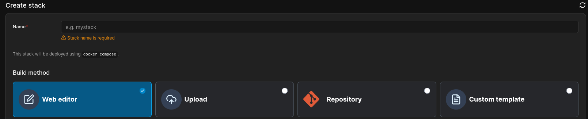

# redeploy-portainer-stack

Redeploy a Portainer CE **Web editor** stack from GitHub Actions CI.

Yes, it has to be a **Web editor** stack:



I made this because I needed a maintained action like this for use in my personal projects.

Here's a straight-to-the-point usage example:

```yaml
steps:
  - name: Build & publish Docker image
    # ...

  - name: Redeploy Portainer stack
    uses: nonk123/redeploy-portainer-stack@master
    with:
      url: ${{ secrets.PORTAINER_STACK_URL }} # e.g. https://my.portainer.monster/#!/13/docker/stacks/cringe?id=172+...
      username: ${{ secrets.PORTAINER_USERNAME }}
      password: ${{ secrets.PORTAINER_PASSWORD }}
```

## Inputs

Set `with.username` and `with.password` to the login credentials for your Portainer instance. Use the [GitHub Actions secrets feature](https://docs.github.com/en/actions/how-tos/write-workflows/choose-what-workflows-do/use-secrets)! Never write them in plain text!

Then set `with.url` to the exact stack URL you see in your browser, like this one:

```plain
https://my.portainer.monster/#!/13/docker/stacks/cringe?id=172+...
```
